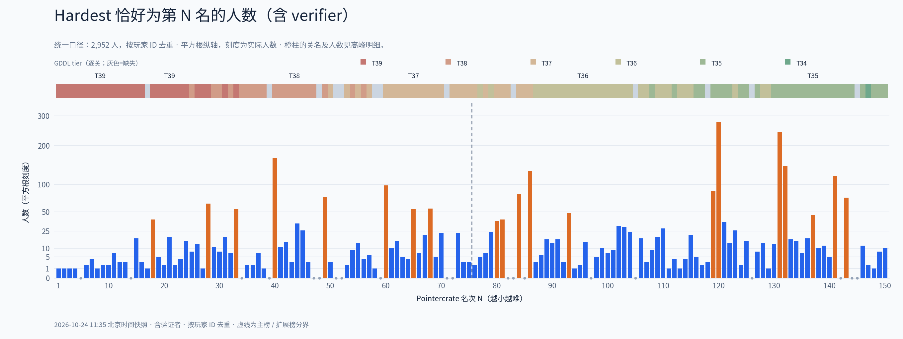
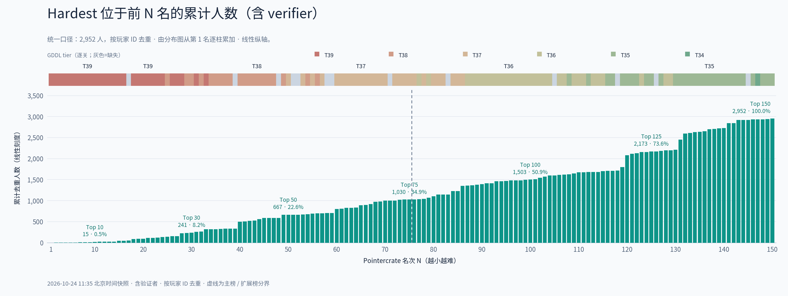
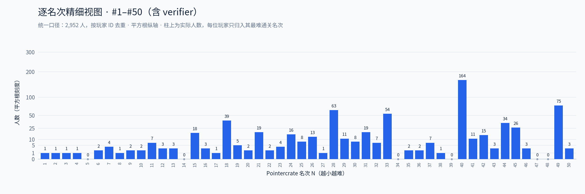
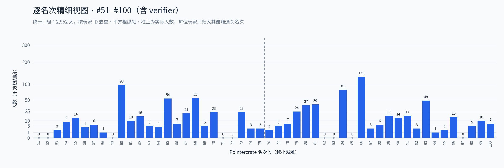
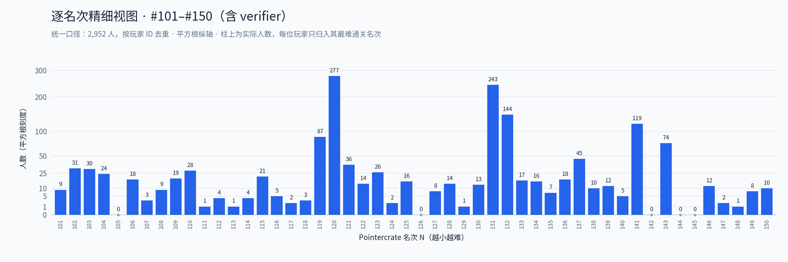

# Pointercrate Top 150 玩家 Hardest 统计

通关数据快照：**2026 年 10 月 24 日 11:35（北京时间）**。这是固定快照，后续榜单变化不会自动更新本页。

**Hardest 位于当时 Top 1–150 的共有 2,952 人（包含验证者）。**
本页的分布图、累计图、高峰明细和精细视图，统一采用**包含 verifier、按玩家 ID 去重**的口径。

## 各名次人数（包含 verifier）



- 纵轴采用**平方根刻度**，刻度标签仍是实际人数。1–25 人的小柱更清楚，最大值仍完整保留；柱高不再与人数成线性比例。
- 每位玩家只归到其最难通关的名次（其已完成关卡中最小的排名数字）。零人数用灰点表示。
- 橙色为明显高于周围的柱子；柱顶不再标排名。高峰明细表保留排名、关名和人数。
- 顶部加粗色带显示逐关 GDDL tier，采用 **T39 柔和红色 → T34 柔和绿色**的渐变；tier 文字置于色带上方，灰色表示未取得评级。GDDL tier 与 Pointercrate 名次存在交错，因此不将整段排名强行视为同一个 tier。
- 灰色竖虚线为 **#75 / #76 主榜与扩展榜分界**，不是 GDDL 分界。

## 累计人数与比例（包含 verifier）



绿色柱为至少通关过前 N 名中一关的累计去重人数。**它直接由上图的同一组含 verifier 人数，从第 1 名起逐柱累加得到**；纵轴保持线性，百分比以全部 2,952 人为分母。

已重新用 10,729 条已批准记录与 150 个关卡的 verifier 信息复算：150 个名次的分布与累计值逐项一致。例如，第 1–10 名各柱之和为 15，累计图 Top 10 也是 15；第 1–150 名各柱之和为 2,952。

| 范围 | 累计人数（含验证者） |
| --- | ---: |
| Top 10 | 15 |
| Top 30 | 241 |
| Top 50 | 667 |
| Top 75 | 1,030 |
| Top 100 | 1,503 |
| Top 125 | 2,173 |
| Top 150 | 2,952 |

## 高峰关卡明细

筛选规则：Hardest 人数至少 35 人，且至少为前后各 4 名关卡人数中位数的 3 倍（中位数小于 1 时按 1 计算）。这里只描述人数集中程度，不推断原因或难度异常。

| 排名 | 关名 | Hardest 人数（含 verifier） | GDDL tier |
| ---: | --- | ---: | ---: |
| 18 | [Silent clubstep](https://gdladder.com/level/4125776) | 39 | 39 |
| 28 | [Acheron](https://gdladder.com/level/73667628) | 63 | 39 |
| 33 | [Kyouki](https://gdladder.com/level/86018142) | 54 | 39 |
| 40 | [Slaughterhouse](https://gdladder.com/level/27690100) | 164 | 38 |
| 49 | [Sakupen Circles](https://gdladder.com/level/76962930) | 75 | 38 |
| 60 | [Firework](https://gdladder.com/level/75206202) | 98 | 37 |
| 65 | [poocubed](https://gdladder.com/level/85133223) | 54 | 37 |
| 68 | [Saul Goodman](https://gdladder.com/level/90477539) | 55 | 37 |
| 80 | [Sevvend Clubstep](https://gdladder.com/level/120255728) | 37 | 37 |
| 81 | [Edge of Destiny](https://gdladder.com/level/89187968) | 39 | 37 |
| 84 | [Solar Flare](https://gdladder.com/level/90390075) | 81 | 37 |
| 86 | [LIMBO](https://gdladder.com/level/86084399) | 130 | 37 |
| 93 | [The Plunge](https://gdladder.com/level/113220284) | 48 | 36 |
| 119 | [Sonic Wave Infinity](https://gdladder.com/level/69685815) | 87 | 35 |
| 120 | [Tartarus](https://gdladder.com/level/59075347) | 277 | 35 |
| 131 | [The Golden](https://gdladder.com/level/60978746) | 243 | 35 |
| 132 | [Oblivion](https://gdladder.com/level/71025973) | 144 | 35 |
| 137 | [Verdant Landscape](https://gdladder.com/level/76543324) | 45 | 35 |
| 141 | [UNKNOWN](https://gdladder.com/level/88203501) | 119 | 35 |
| 143 | [Shukketsu](https://gdladder.com/level/75286957) | 74 | 35 |

## 逐柱精细视图

每张仅展示 50 个名次，柱顶直接写出人数。三张均包含 verifier，并使用相同的平方根纵轴，便于比较。

<details>
<summary>展开查看 #1–50</summary>



</details>

<details>
<summary>展开查看 #51–100</summary>



</details>

<details>
<summary>展开查看 #101–150</summary>



</details>

## 数据来源与口径

- 全部图表统一包含 verifier：按 Pointercrate 玩家 ID 去重，将公开已批准的 100% 记录与榜单验证者合并；同一人即使有多条记录或验证多个关卡，也只按其最靠前的已通关名次归类一次。
- CSV 中保留的 `approved_records_only` 字段属于对照数据；本页所有图表均使用 `including_verifiers` 系列。绘图脚本检查每个名次的累计值是否等于前面各柱之和。
- 不包含未提交的实际通关。抓取前后，前 150 名的排名和验证者一致；通关记录为抓取期间取得的数据，并非数据库的原子快照。
- GDDL 评级抓取于 **2026-10-24 11:57–12:01（北京时间）**，与通关数据的采集时间分别记录。按 Geometry Dash 关卡 ID 精确匹配，**137 / 150 关有评级，13 关保留空值**。
- GDDL tier 优先将 `Rating` 四舍五入为整数（0.5 向上）；无 `Rating` 时使用官方 `DefaultRating`。评级缺失时不通过排名推算。逐关值、来源类型、评分数及链接保留在 CSV 中。
- [Pointercrate](https://pointercrate.com/) · [GDDL](https://gdladder.com/) · [GDDL 匹配与采集元数据](gddl_metadata.json)。

## 下载与复现

[总览 PNG](hardest_top150_charts.png) · [矢量 SVG](hardest_top150_charts.svg) · [PDF](hardest_top150_charts.pdf)

[150 个名次的统计 CSV](hardest_by_rank.csv) · [高峰关卡 CSV](peak_levels.csv) · [逐关 GDDL tier CSV](gddl_tiers.csv) · [统计汇总 JSON](summary.json)

安装 Python 的 `matplotlib` 和 `numpy` 后，在仓库根目录运行：

```bash
python scripts/render_charts.py
```

该命令仅使用仓库内的 CSV 和 JSON 重绘，不抓取新通关记录，不改变统计快照。
需要刷新 GDDL 评级时，可运行 `python scripts/fetch_gddl_tiers.py`；已缓存的 API 响应位于被 Git 忽略的 `data/gddl/`，重新抓取前可自行移走该缓存，再运行绘图命令。
