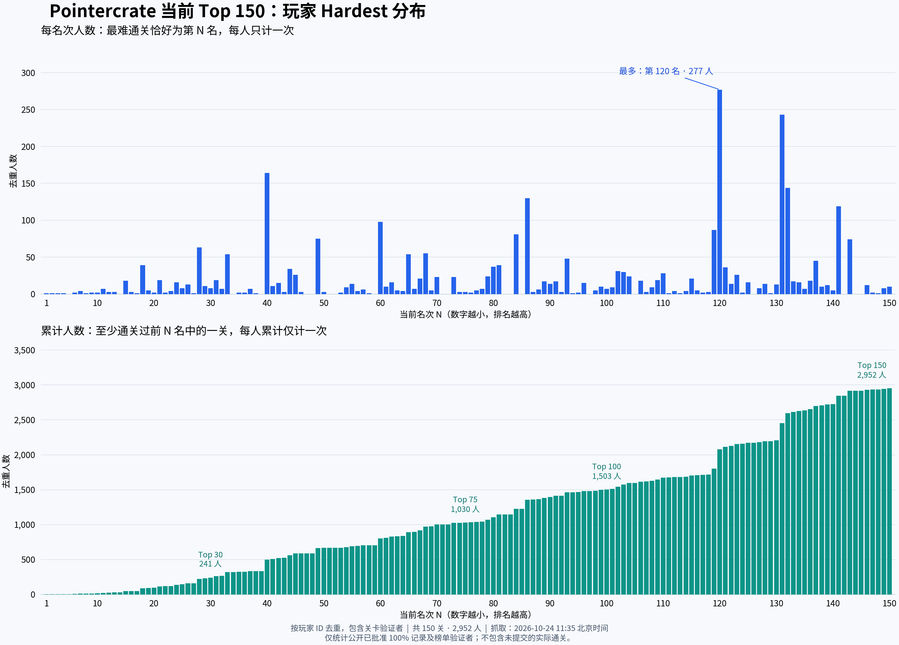

# Pointercrate Top 150 玩家 Hardest 统计

数据抓取时间：2026 年 10 月 24 日 11:35（北京时间）。这是该时间的数据快照。

**Hardest 位于当时 Top 1–150 的共有 2,952 人（包含验证者）。**
仅计已批准的 100% 通关记录为 2,934 人，另有 18 名验证者。

- 蓝色柱：最难通关恰好为当前第 N 名的人数，每人只计一次。
- 绿色柱：至少通关过前 N 名中一关的累计去重人数。
- 按 Pointercrate 玩家 ID 去重，将已批准的 100% 通关记录与榜单验证者合并。
- 验证者也按其最靠前的通关名次归类；仅统计公开数据，不包含未提交的实际通关。
- 抓取前后，前 150 名的排名及验证者一致；通关记录为抓取期间取得的数据。

| 范围 | 累计人数（含验证者） |
| --- | ---: |
| Top 10 | 15 |
| Top 30 | 241 |
| Top 50 | 667 |
| Top 75 | 1,030 |
| Top 100 | 1,503 |
| Top 125 | 2,173 |
| Top 150 | 2,952 |

人数最多的单个 Hardest 名次：第 120 名 Tartarus，277 人。

[逐名次统计 CSV](hardest_by_rank.csv) · [统计汇总 JSON](summary.json) · [查看 PNG 原图](hardest_top150_charts.png)

来源：[Pointercrate](https://pointercrate.com/)，公开榜单及已批准的 100% 通关记录。
