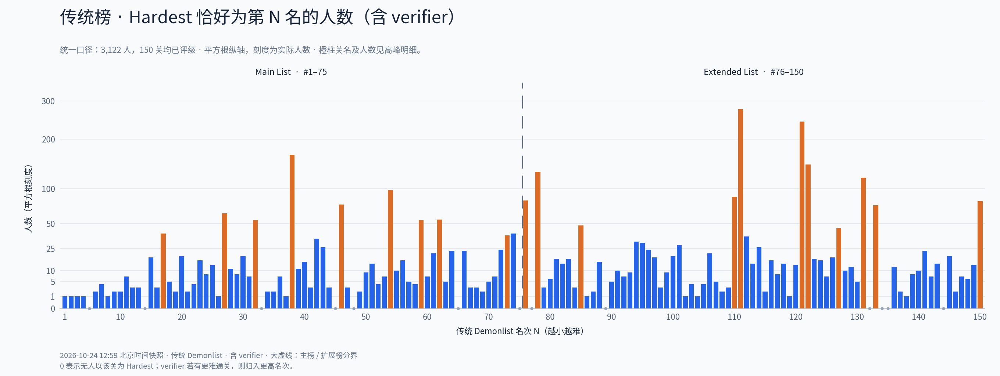
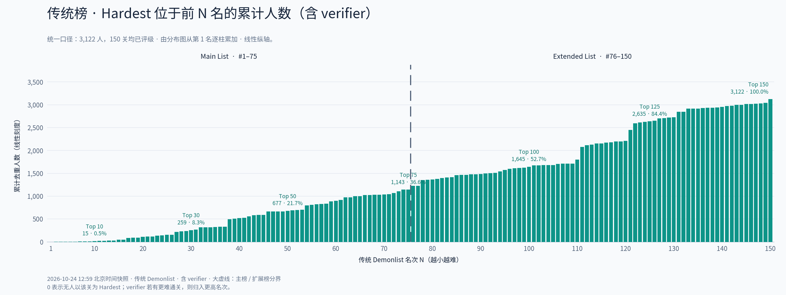
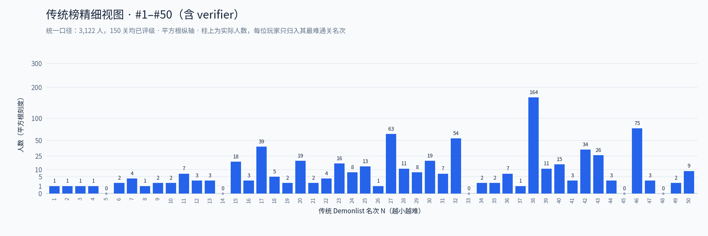
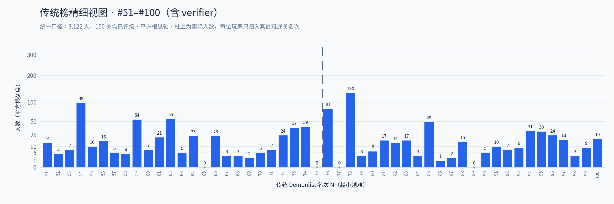
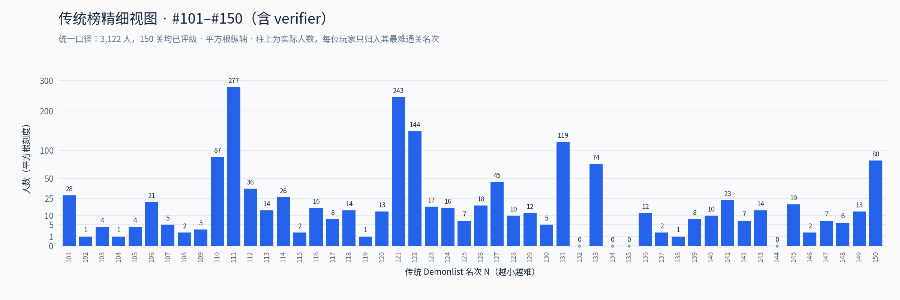

# 传统 Pointercrate Demonlist Top 150 · 玩家 Hardest 统计

**本页使用传统 Demonlist：只统计游戏内已评级关卡，以 `rated_position` 第 1–150 名为准。**
Main List 为第 1–75 名，Extended List 为第 76–150 名。综合排名 `position` 不作为本页排名依据。

快照完成时间：**2026 年 10 月 24 日 12:59（北京时间）**。这是固定快照，后续榜单变化不会自动更新本页。

**共有 3,122 人至少通关传统榜前 150 名中的一关（包含 verifier，按玩家 ID 去重）。**
分布图、累计图、高峰明细和精细视图均使用同一统计口径。

## Hardest 分布（包含 verifier）



- 每人只归入自己通关过的最难关卡名次（最小的 `rated_position`），在分布图中仅出现一次。
- 平方根纵轴放大小数值，刻度仍是实际人数；柱高不与人数成线性比例。
- 橙色为明显高于周围的柱子，高峰明细保留名次、关名和人数。
- 大虚线位于 #75 / #76 之间，区分 Main List 与 Extended List。
- 零值表示无人以该关为 Hardest；verifier 若通关过更难关卡，就计入更高名次。

## 累计人数（包含 verifier）



累计图直接对分布图第 1–N 名的人数求和，纵轴保持线性。百分比以全部 3,122 人为分母。
已对 150 个累计阈值分别核对：累计柱高与“至少通关前 N 名中一关”的玩家 ID 集合大小一致。

| 范围 | 累计人数（含 verifier） | 占全部样本 |
| --- | ---: | ---: |
| Top 1 | 1 | 0.0% |
| Top 10 | 15 | 0.5% |
| Top 30 | 259 | 8.3% |
| Top 50 | 677 | 21.7% |
| Top 75 | 1,143 | 36.6% |
| Top 100 | 1,645 | 52.7% |
| Top 125 | 2,635 | 84.4% |
| Top 150 | 3,122 | 100.0% |

## 高峰关卡明细

共 20 个高峰。筛选规则：Hardest 人数至少 35 人，且至少为前后各 4 名中位数的 3 倍（中位数小于 1 时按 1 计算）。描述人数集中程度，不推断原因。

| 传统榜排名 | 关名 | Hardest 人数（含 verifier） |
| ---: | --- | ---: |
| 17 | Silent clubstep | 39 |
| 27 | Acheron | 63 |
| 32 | Kyouki | 54 |
| 38 | Slaughterhouse | 164 |
| 46 | Sakupen Circles | 75 |
| 54 | Firework | 98 |
| 59 | poocubed | 54 |
| 62 | Saul Goodman | 55 |
| 73 | Sevvend Clubstep | 37 |
| 76 | Solar Flare | 81 |
| 78 | LIMBO | 130 |
| 85 | The Plunge | 48 |
| 110 | Sonic Wave Infinity | 87 |
| 111 | Tartarus | 277 |
| 121 | The Golden | 243 |
| 122 | Oblivion | 144 |
| 127 | Verdant Landscape | 45 |
| 131 | UNKNOWN | 119 |
| 133 | Shukketsu | 74 |
| 150 | Trueffet | 80 |

## 零值核对

已核对 13 个零值关卡，verifier 均已计入其更难通关的名次。

- #5 Amethyst 的 verifier **[WBT] wPopoff**，归入 **#3 Society**。
- #14 The Bloop 的 verifier **[67] Zoink**，归入 **#2 Artemis 13**。

[完整零值核对表](zero_bin_audit.csv)同时列出每关通关人数与 verifier 的 Hardest 归属。

## 逐柱精细视图

三张图使用同一平方根纵轴范围，柱顶直接标出实际人数。

<details>
<summary>展开查看传统榜 #1–50</summary>



</details>

<details>
<summary>展开查看传统榜 #51–100</summary>



</details>

<details>
<summary>展开查看传统榜 #101–150</summary>



</details>

## 数据与验证

- 150 个关卡全部满足 `rated=true`，`rated_position` 完整覆盖 1–150；第 75 名为 **Losing Your Mind**，第 150 名为 **Trueffet**。
- 采集到 11,949 条已批准的 100% 记录；将记录中的玩家 ID 与验证者 ID 合并，同一人只计一次。
- 抓取前后核对 150 关的传统排名、关卡 ID 与 verifier 身份，均保持一致。
- 记录接口的 `demon_position__lt` 是综合名次范围，所以扩大到能覆盖传统第 150 名，再按这 150 个已评级关卡 ID 过滤；未评级关卡记录不会进入统计。
- `approved_records_only` 字段保留为对照数据，本页图表统一使用 `including_verifiers` 系列。
- 只覆盖公开批准记录和验证者，不包含未提交的实际通关；数据是在采集区间内取得，并非数据库原子快照。
- 来源：[Pointercrate 传统 Demonlist](https://pointercrate.com/demonlist/)。

## 下载

[传统榜总览 PNG](charts/traditional/hardest_top150_charts.png) · [SVG](charts/traditional/hardest_top150_charts.svg) · [PDF](charts/traditional/hardest_top150_charts.pdf)

[150 个名次统计](hardest_by_rank.csv) · [玩家明细](players.csv) · [高峰明细](peak_levels.csv) · [零值核对](zero_bin_audit.csv) · [统计汇总](summary.json)

[关卡 API 快照](data/levels.json) · [原始批准记录 gzip JSON](data/records.json.gz) · [采集元数据](data/collection.json)

## 复现

安装 Python 的 `matplotlib` 和 `numpy`。使用仓库内的固定快照重算并绘图：

```bash
python scripts/collect_traditional.py --reuse-data
python scripts/render_charts.py
python scripts/update_readme.py
```

如需从 API 抓取新的传统榜快照，将第一条命令改为 `python scripts/collect_traditional.py`，其余步骤相同。
历史版本中的综合榜数据不作为本页传统榜统计结果。
